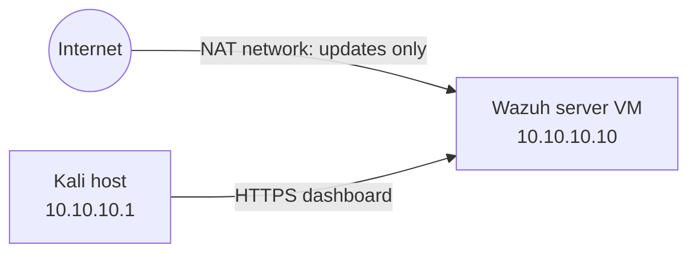

# homelabb
# Home SOC Lab with Wazuh

A home Security Operations Center lab built on a Kali Linux host using KVM virtualization, with Wazuh as the SIEM. This document records how the lab was built, including the problems that came up along the way.

## Contents

1. [The idea](#1-the-idea)
2. [Architecture](#2-architecture)
3. [Installation of programs on Kali Linux](#3-installation-of-programs-on-kali)
4. [Installation and configuration of Ubuntu Server](#4-installation-and-configuration-of-ubuntu-server)
5. [Configuration of Wazuh](#5-configuration-of-wazuh)
6. [First log in](#6-first-log-in)

---

## 1. The idea

The goal of this project is to understand how a SOC works from end to end: how logs are collected, how a SIEM analyzes them, and how alerts are raised and investigated. Instead of only reading about it, I built the environment myself on my own hardware using free tools.

Three principles shaped the design:

- **Isolation:** the lab runs on a virtual network with no route to my home network, so suspicious activity can be generated safely later.
- **Realism:** the SIEM is Wazuh, a real and widely deployed open-source platform.
- **Repeatability:** every important stage is saved as a VM snapshot, so any mistake can be rolled back in minutes.

## 2. Architecture



| Component | Role | Specs |
|---|---|---|
| Kali Linux (host) | Hypervisor (KVM + virt-manager) and analyst workstation | ~15 GB RAM total |
| `wazuh` VM | SIEM: indexer, manager, dashboard | Ubuntu Server 22.04, 6 GB RAM, 4 vCPU, 50 GB disk |

Two virtual networks connect them:

- `soc-lab` (10.10.10.0/24) is isolated, with no route to the home LAN or the internet.
- `default` (NAT) exists only so the Wazuh VM can download packages and updates.

The Wazuh VM has two network cards, one on each network. The Kali host sits on the lab network at 10.10.10.1.

## 3. Installation of programs on Kali Linux

Before installing anything I confirmed that the machine could run virtual machines: the CPU reported VT-x support across all 16 logical cores, and `/dev/kvm` was present. The machine had about 15 GB of RAM and 133 GB of free disk space on the partition that holds the VM disk images.

The virtualization stack was installed from the Kali repositories:

```bash
sudo apt install -y qemu-system-x86 libvirt-daemon-system libvirt-clients \
  virtinst virt-manager dnsmasq-base bridge-utils
sudo usermod -aG libvirt,kvm $USER
sudo systemctl enable --now libvirtd
```

After logging out and back in for the group change, `virsh` connected to the system hypervisor without errors and showed an empty VM list. I set `LIBVIRT_DEFAULT_URI=qemu:///system` in `~/.zshrc` so every `virsh` command targets the system session by default.

### Lab network

The isolated network was defined with libvirt. It has no `<forward>` element, which is what keeps it isolated. The Kali host takes 10.10.10.1 on it:

```xml
<network>
  <name>soc-lab</name>
  <bridge name='virbr-soc' stp='on' delay='0'/>
  <ip address='10.10.10.1' netmask='255.255.255.0'>
    <dhcp><range start='10.10.10.100' end='10.10.10.200'/></dhcp>
  </ip>
</network>
```

Both `default` and `soc-lab` are active with autostart enabled. The `virbr-soc` bridge shows `DOWN` until a VM attaches to it, which is normal behavior.

### Installation image

I used Ubuntu Server 22.04.5 LTS and copied the ISO into `/var/lib/libvirt/images/`, because QEMU often cannot read files from a home directory.

> **Problem: wrong Ubuntu version.**
> I first downloaded Ubuntu 26.04, which is not on Wazuh's supported operating-system list. The installer can refuse to run on an unsupported OS, and I would only have found that out after finishing the Ubuntu install. I deleted that ISO and used 22.04 LTS instead.
> **Lesson:** check the vendor's supported-platform list before downloading an OS image.

## 4. Installation and configuration of Ubuntu Server

### VM setup

The `wazuh` VM was created in virt-manager with these settings:

| Setting | Value |
|---|---|
| ISO | Ubuntu Server 22.04.5 |
| Memory / CPUs | 6144 MB / 4 |
| Disk | 50 GB |
| NIC 1 | `default` (NAT), virtio |
| NIC 2 | `soc-lab`, virtio |

The VM was customized before installation so both network cards were in place from the first boot. The Ubuntu installer was used with the standard server profile, the default storage layout, no featured snaps, and OpenSSH server enabled, so the VM could be managed over SSH from the Kali terminal.

After installation, the interfaces came up as `enp1s0` (NAT, `192.168.122.101`) and `enp2s0` (lab, DHCP lease from the `soc-lab` range). Internet access worked through the NAT interface.

### Static IP for the lab interface

Wazuh needs a stable address, because every agent will point at it, so the lab interface was given a fixed address in netplan:

```yaml
network:
  version: 2
  ethernets:
    enp1s0:
      dhcp4: true
    enp2s0:
      addresses: [10.10.10.10/24]
```

The lab interface has no gateway on purpose. Internet traffic leaves through the NAT interface, and the lab interface only talks to the lab network. The change was applied with `netplan try`, which rolls back automatically if connectivity is lost.

> **Problem: a stale DHCP address survived the static IP.**
> **Symptom:** `enp2s0` showed two addresses, `10.10.10.10` (static) and a leftover DHCP address.
> **Cause:** `/etc/netplan/50-cloud-init.yaml` still had `dhcp4: true` for that interface. Netplan merges every file in the directory, so both configurations applied. Cloud-init also regenerates that file on every boot, so deleting it alone would not have lasted.
> **Fix:** cloud-init's network management was disabled with `network: {config: disabled}` in `/etc/cloud/cloud.cfg.d/99-disable-network-config.cfg`, and the generated file was moved out of `/etc/netplan/`.
> **Verification:** after a reboot, `enp2s0` held only `10.10.10.10/24` and the netplan directory contained a single file.
> **Lesson:** deleting an address with `ip addr del` only lasts until the next reboot. The real fix is finding what keeps re-applying the configuration, and verifying it across a restart.

### Disk size

The login banner showed the root filesystem at about 23 GB on a 50 GB disk. Ubuntu's default LVM layout does not allocate the whole volume group to the root volume. Since the Wazuh indexer grows quickly, the volume was extended to use all free space before any installation:

```bash
sudo lvextend -r -l +100%FREE /dev/ubuntu-vg/ubuntu-lv
```

The root filesystem grew to 48 GB.

### Updates and first snapshot

The system was fully updated and rebooted. I stayed on 22.04 and did not accept the 24.04 release upgrade offered at login. With the VM shut down, the first snapshot, `base-ubuntu`, was taken from the Kali host. Snapshotting a powered-off VM keeps the snapshot small and consistent.

## 5. Configuration of Wazuh

### Installation

I connected to the VM over SSH at 10.10.10.10 and ran the installation inside `tmux`, so a dropped connection could not interrupt it. Wazuh 4.14 was installed with the official installation assistant in all-in-one mode, which places the indexer, manager, and dashboard on a single host:

```bash
curl -sO https://packages.wazuh.com/4.14/wazuh-install.sh && sudo bash ./wazuh-install.sh -a
```

The installation took about ten minutes. It finished by printing the dashboard address and a generated password for the `admin` user, which I stored in a password manager.

### Verification

All three services, `wazuh-manager`, `wazuh-indexer`, and `wazuh-dashboard`, report `active`. They also started on their own after a reboot, which confirmed the installation survives a restart.

### Preventing accidental upgrades

A routine `apt upgrade` could update one Wazuh component to a version that no longer matches the others and break the stack. To avoid that, the Wazuh apt repository entry was commented out after installation. `grep -c '^deb' /etc/apt/sources.list.d/wazuh.list` returns `0`, and `apt update` completes cleanly.

### Second snapshot

With the VM shut down, a second snapshot, `wazuh-installed`, was taken. The VM now has two restore points: `base-ubuntu` (clean OS) and `wazuh-installed` (working SIEM).

### Operating notes

- The VM is always stopped with `virsh shutdown`, never powered off abruptly, because the indexer holds a database.
- After starting the VM, the dashboard needs one to two minutes before the indexer is ready.
- Passwords, certificates, and the `wazuh-install-files.tar` archive are kept out of this repository.

## 6. First log in

The dashboard is reachable from the Kali host at `https://10.10.10.10`. The browser shows a certificate warning, because Wazuh generates a self-signed certificate during installation. This is expected in a lab, so the exception was accepted, and I logged in as `admin` with the generated password.


The overview page loads with the main Wazuh modules available: configuration assessment, malware detection, file integrity monitoring, threat hunting, vulnerability detection, and MITRE ATT&CK mapping.
